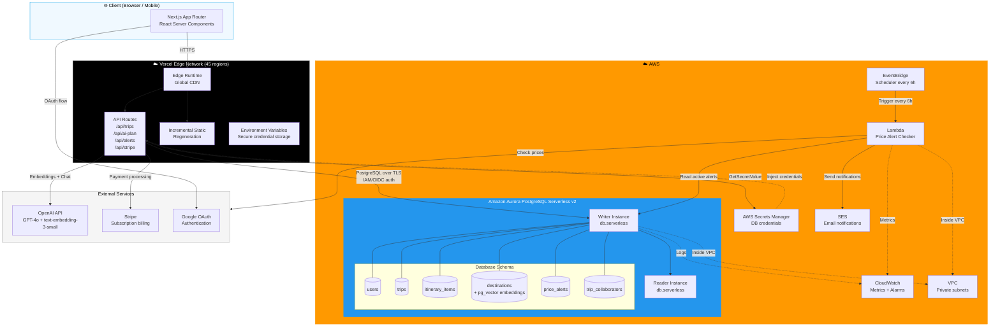
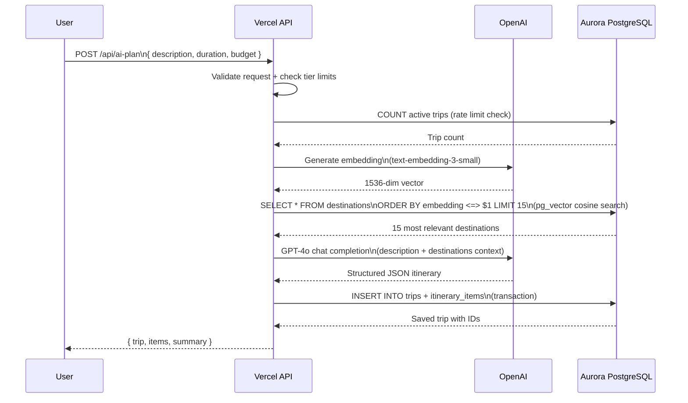

# Wandr — Architecture Design Document

## System Architecture Overview

## Component Breakdown

| Component | Technology | Responsibility |
|---|---|---|
| Frontend | Next.js 14 App Router | Server-rendered React UI, streaming, SEO |
| Styling | Tailwind CSS + shadcn/ui | Professional UI components |
| Animations | Framer Motion | Polished micro-interactions |
| API Layer | Next.js Route Handlers | REST API, auth middleware, rate limiting |
| Database ORM | postgres.js | Type-safe Aurora PostgreSQL queries |
| AI Embeddings | OpenAI text-embedding-3-small | 1536-dim vectors for destination search |
| AI Generation | OpenAI GPT-4o | Natural language → structured itinerary |
| Vector Search | pg_vector (Aurora extension) | Cosine similarity over destination embeddings |
| Authentication | NextAuth.js | Session management, Google OAuth |
| Payments | Stripe | Subscription tiers, webhook processing |
| Infrastructure | AWS CloudFormation | Reproducible IaC deployment |
| Monitoring | CloudWatch | Metrics, alarms, Aurora performance insights |

## Aurora PostgreSQL — Why This Database?

Aurora PostgreSQL Serverless v2 is the ideal database for Wandr because:

1. **Complex relationships**: Trips contain itinerary items, linked to destinations, with collaborators — requires JOINS, foreign keys, transactions
2. **pg_vector extension**: Stores 1536-dimensional AI embeddings directly in Aurora, enabling semantic destination search without a separate vector database
3. **Full-text search**: `tsvector`/`tsquery` for keyword search over destination names and descriptions
4. **Row-level security**: Per-user trip isolation at the database layer — not just application layer
5. **Serverless scaling**: Aurora pauses during low traffic (cost optimization) and scales to 64 ACUs during peak
6. **Materialized views**: Pre-computed trip analytics refresh daily without impacting live query performance
7. **ACID transactions**: Critical for collaborative editing — multiple users editing the same trip safely

## Data Flow: AI Itinerary Generation

## Security Architecture

| Concern | Implementation |
|---|---|
| Database credentials | AWS Secrets Manager — never in code or env files |
| Vercel → AWS auth | Vercel OIDC (no long-lived AWS keys) |
| Database access | Aurora in private VPC subnets, no public exposure |
| Row-level security | PostgreSQL RLS policies enforce user isolation at DB layer |
| API authentication | NextAuth.js session validation on every API route |
| Input validation | Zod schemas on all API inputs |
| Security headers | X-Frame-Options, CSP, Referrer-Policy on all routes |
| Payment data | Never stored — Stripe handles all card data |

## Scalability Design

- **Aurora Serverless v2**: Scales from 0.5 to 64 ACUs automatically; handles traffic spikes
- **Read replicas**: Heavy analytics queries routed to reader instance
- **pg_vector HNSW index**: O(log n) approximate nearest-neighbor — scales to millions of destinations
- **Vercel Edge**: Global CDN reduces latency; ISR caches popular destination pages
- **Connection pooling**: postgres.js pool prevents connection exhaustion under concurrent Vercel function invocations
- **Lambda for async work**: Price alert checking offloaded from critical path
